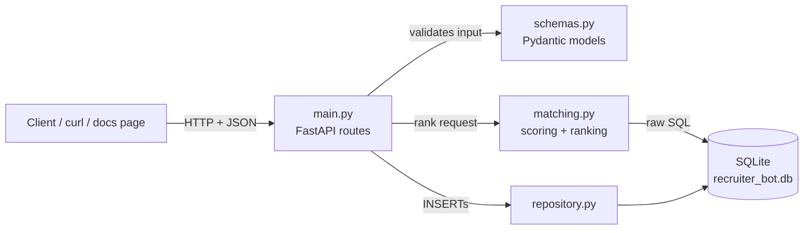

# TalentMatch: Recruiter Bot

### A FastAPI + SQLite service that ranks candidates for jobs, and jobs for candidates, with an explainable score

Recruiter Bot loads candidates and job openings into a SQLite database and exposes a small REST API. Ask it for the best candidates for a job, or the best jobs for a candidate, and every result comes back with a score from 0 to 100, a points breakdown, and a one-line reason a recruiter can read. All database access is hand-written SQL (no ORM), and the scoring rules are simple enough to explain and tune.

## How it works



A request hits a route in `main.py`. Pydantic checks any input. `matching.py` asks the database which skills and culture keywords overlap (raw SQL), scores each pair, filters and sorts, and returns JSON.

## Quick start

Requires Python 3.10 or newer.

**Linux / macOS / WSL:**

```bash
git clone https://github.com/Mubashirfree/talentmatch.git
cd talentmatch
python3 -m venv .venv && source .venv/bin/activate
pip install -r requirements.txt
python -m recruiter_bot.seed                 # creates recruiter_bot.db (15 candidates, 6 jobs)
uvicorn recruiter_bot.main:app --reload      # http://127.0.0.1:8000
```

**Windows (PowerShell):**

```powershell
git clone https://github.com/Mubashirfree/talentmatch.git
cd talentmatch
py -m venv .venv
.venv\Scripts\Activate.ps1
pip install -r requirements.txt
python -m recruiter_bot.seed
uvicorn recruiter_bot.main:app --reload
```

If activation is blocked, run `Set-ExecutionPolicy -Scope CurrentUser RemoteSigned` once.
In PowerShell, use the `/docs` page (or `curl.exe` / `Invoke-RestMethod`) to try the API.

Interactive API docs (try every endpoint in the browser): http://127.0.0.1:8000/docs

### API

| Endpoint | Purpose |
|---|---|
| `GET /jobs`, `GET /candidates` | List records and their ids |
| `GET /jobs/{id}/matches` | Ranked candidates for a job. Options: `limit`, `min_score`, `available_only` |
| `GET /candidates/{id}/matches` | Ranked jobs for a candidate. Options: `limit`, `min_score` |
| `POST /candidates`, `POST /jobs` | Add a record. `201` on success, `422` on invalid input, `409` on a duplicate name |

Unknown ids return `404`.

```bash
curl http://127.0.0.1:8000/jobs
curl http://127.0.0.1:8000/jobs/1/matches
curl "http://127.0.0.1:8000/jobs/6/matches?limit=3&available_only=true"
curl http://127.0.0.1:8000/candidates/6/matches
curl -X POST http://127.0.0.1:8000/candidates -H "Content-Type: application/json" \
  -d '{"name":"Nancy D.","experience_years":6,"availability":"Immediate","skills":["deduction"]}'
```

Example result (`/jobs/1/matches`, top match):

```json
{
  "candidate_id": 1,
  "name": "Sherlock H.",
  "experience_years": 8,
  "score": 95.0,
  "breakdown": {"skills": 55.0, "experience": 20.0, "culture": 5.0, "availability": 15.0},
  "reason": "Matches 3/3 required skills (deduction, forensics, pattern-recognition); 8 yrs vs 3 required; availability: Immediate; culture fit: analytical"
}
```

### Scoring

| Part | Weight | Formula |
|---|---|---|
| Skills | 55% | matched required skills ÷ total required skills |
| Experience | 20% | min(candidate years ÷ job minimum, 1) |
| Culture | 10% | matched culture keywords ÷ total keywords |
| Availability | 15% | Immediate 1.0, 2 weeks 0.7, Not looking 0.2 |

The breakdown shows the points each part contributed, and the parts add up to the score. Candidates with zero matching skills are excluded. Ties are broken by experience, then name.

## Development

```bash
source .venv/bin/activate
python -m pytest -q          # 17 tests: unit tests for scoring, integration tests for the API
python -m recruiter_bot.seed # reset the local database to the original data
```

Tests run against a throwaway database: the `RECRUITER_BOT_DB` environment variable points the app at a temporary file, so your real `recruiter_bot.db` is never touched.

```
recruiter_bot/
  db.py            connection helper (sqlite3, foreign keys on)
  schema.sql       hand-written DDL
  repository.py    shared INSERT helpers
  seed_data.py     the 15 candidates and 6 jobs
  seed.py          loads the data
  matching.py      scoring and ranking
  schemas.py       Pydantic request/response models
  main.py          FastAPI routes
tests/             unit and integration tests
sql_detective/     Part 2
```

## Design decisions and trade-offs

**Skills are rows, not a text column.** I store each skill as its own row (`candidate_skills`, `job_skills`, and the same for traits and culture) instead of a comma-separated string. That lets SQL do the matching with a JOIN and count overlaps itself, and a primary key on (candidate, skill) stops duplicates. The cost is more tables, which I think is worth it for a many-to-many relationship.

**The scoring is a weighted sum.** Skills get the biggest weight (55%) because a candidate who can't do the job's core work shouldn't win on anything else. Experience is 20%, availability 15% and culture 10%, since culture keywords are the softest signal. The weights are guesses I chose to be reasonable and explainable, not something learned from data, and they live in one dictionary so they're easy to change. Experience is capped at 1.0: ten years against a two-year minimum earns no more than two years does, because "meets the bar" is what the job asks for.

**Zero-skill candidates are excluded; availability is a soft factor.** If someone shares none of a job's required skills, they aren't a match no matter how senior or available they are. Availability works the other way: someone who isn't looking is still worth showing, just lower, because a recruiter may still want to approach a strong fit.

**Matches are computed on request, not stored.** Results are always fresh, and there's no second table to keep in sync when someone edits a skill. The cost is that every request recomputes scores. That's fine for 15 candidates and 6 jobs. At scale I'd move the scoring into one set-based SQL query, add pagination, cache or precompute top matches per job, and move to Postgres, since SQLite handles only one writer at a time.

**Known weaknesses.** Michael S. is "Not looking" yet ranks second for Sales Engineer (64.7), because his skills fit well. I left that in on purpose, and `?available_only=true` removes him. Skill matching is exact-string, so "python3" and "python" don't match, and there are no synonyms. Culture matching is the same. A production version would need normalised skill vocabularies.

**Why FastAPI.** It gives automatic input validation and an interactive `/docs` page with almost no extra code. I ruled out Django because its main feature, the ORM, is banned by the brief, and Flask because validation and docs would have to be added by hand. The routes are plain `def`, not `async def`, because `sqlite3` is blocking and FastAPI runs plain routes in a thread pool.

**Validation and errors.** Pydantic rejects bad input with `422` before it reaches the database, and the database's `CHECK` constraints stay as a second safety net. Skills are normalised (`"Public Speaking "` becomes `public-speaking`) so new records match the stored ones. Errors are specific: `404` unknown id, `409` duplicate, `422` invalid input, `201` created.

**Testing.** The scoring is pure functions, so unit tests check the maths with no database: a perfect match scores exactly 100, experience is capped, and the breakdown adds up to the score. The integration tests call the API over HTTP against a temporary database. They check ranking, each filter, the reverse direction, 404, 409 and 422 handling, and that new records show up in matches.

## Part 2: SQL Detective

`sql_detective/setup.sql` loads the dataset exactly as given, and `sql_detective/sql_detective.sql` answers Q1 to Q5.

```bash
sqlite3 sql_detective/hiring.db < sql_detective/setup.sql
sqlite3 -header -column sql_detective/hiring.db < sql_detective/sql_detective.sql
```

- **Q2:** the `Final` filter sits in the `LEFT JOIN`'s `ON` clause, so postings with zero finalists still appear.
- **Q3:** the `applicants` table has no job column, so I infer "applied to a posting" from interviews. Duplicate people (Ananya Rao appears twice with different email casing) are merged by `LOWER(email)`, and `COUNT(DISTINCT job_posting_id)` stops one posting being counted more than once.
- **Q4:** uses `100.0 *` to force decimal division, because SQLite divides integers as integers.
- **Q5:** a `DENSE_RANK()` window function partitioned by department, so tied recruiters both show up.

## AI usage

I used Claude (Anthropic) throughout this project. It helped me plan the architecture and build order, and I used it to generate the first version of the code based on the features I wanted and the structure of this README. I then typed the code into my editor file by file and ran it. I fixed the errors that came up and changed the logic wherever it didn't match. This included fixing SQL and Python typos, a merged route, and an incorrect status code by using tracebacks, code review, and the test suite. I tested every endpoint with curl. For Part 2, I wrote my own attempts for all five queries, ran them, and checked and corrected the results. The explanations in this README were drafted with Claude's help, and I verified them against the code. I can walk through any file and explain how it works.